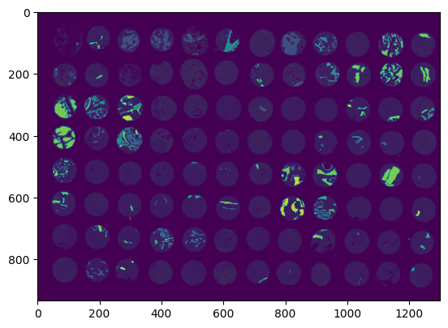

# Neural Networks from Scratch

A fully connected neural network written in NumPy, without any deep learning framework. It handles both classification and regression, trains with backpropagation and L2 regularization, and uses numerical gradient checking to make sure the gradients are right.

I also applied it to a real problem: classifying tissue types from FTIR spectroscopy images.



## What's in the repo

- `nn.py`: the network, the training loop and a small command-line interface
- `test_nn.py`: unit tests, including the gradient checks
- `competition.ipynb`: training and predictions for the FTIR tissue classification task
- `datasets/`: two small toy datasets (`doughnut.tab`, `squares.tab`) for quick experiments

## Running it

```bash
git clone https://github.com/alihawk/ann-from-scratch.git
cd ann-from-scratch
pip install -r requirements.txt
```

Train a network with two hidden layers:

```bash
python nn.py --units 8,4 --activations relu,tanh --lambda 0.01 --epochs 3000
```

Run the tests:

```bash
python test_nn.py
```

The FTIR experiment is in `competition.ipynb`.

## License

MIT
